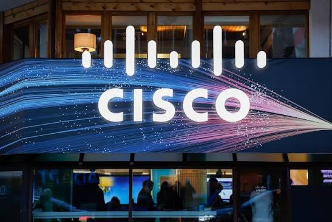
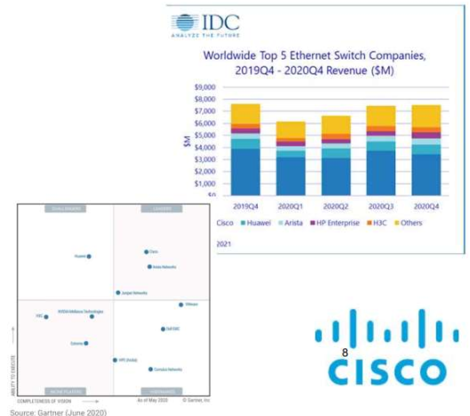
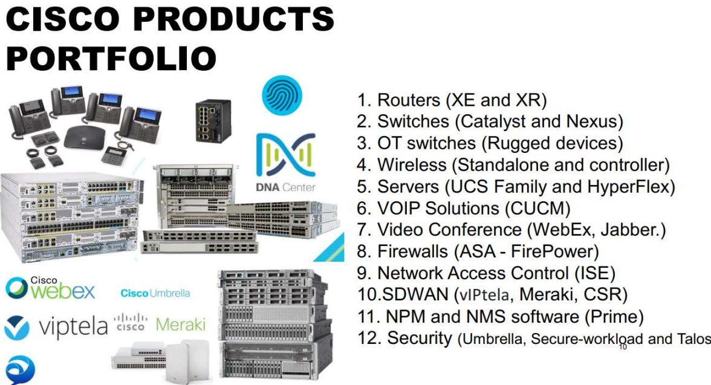
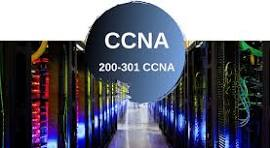
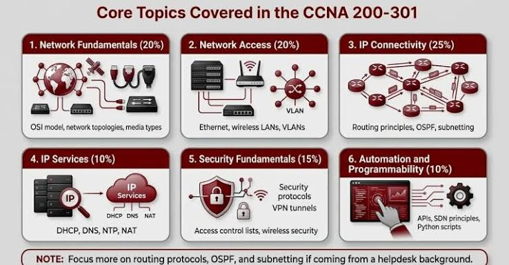

# 0-CCNA-200-301 Orientation:

## 0.1-About CISCO System Company:

0.1.1-CISCO System Company Is Founded In San FranCISCO In USA (American United States) In 1984...

<table>
  <tr>
    <th>
      
    </th>
  </tr>
</table>

-------------------------------------------------------------------------------------------------
0.1.2-CISCO System Company Is The Creator Of The CCNA Certification...

-------------------------------------------------------------------------------------------------
0.1.3-CISCO System Company Has 77000 Employees As For 2020...

-------------------------------------------------------------------------------------------------
0.1.4-CISCO System Company Has The Highest Market Share In Many Categories As Per As IDC (Internet Data Co Operation)...

-------------------------------------------------------------------------------------------------
0.1.5-CISCO System Company Is The Leader In Many Area As Per As Gartner...

<table>
  <tr>
    <th>
      
    </th>
  </tr>
</table>
-------------------------------------------------------------------------------------------------
0.1.6-CISCO System Company Portfolio Is Divided Into Four Segments Like SB (Small Business) , MB (Medium Business) , SP (Service Provider) , And Finally Enterprises...

<table>
  <tr>
    <th>
      
    </th>
  </tr>
</table>
-------------------------------------------------------------------------------------------------
0.1.7-CISCO System Company Is A Software System Company , Their Main Products For Many Years Was CISCO IOS (Internetworking Operating Systems)...

-------------------------------------------------------------------------------------------------
## 0.2-About CCNA:

0.2.1-CCNA: It Refers To The CISCO Certified Network Associate...

<table>
  <tr>
    <th>
            
    </th>
  </tr>
</table>
--------------------------------------------------------------------------------------------------
0.2.2-CCNA: It Is Mainly Describing All Network Principles Like Routing (Dynamic , And Static) , IP Connectivity (IPV4 , And IPV6) , VLANS , Switching , OSPF , OSI Model , TCP/IP , And More...

<table>
  <tr>
    <th>
      
    </th>
  </tr>
</table>
--------------------------------------------------------------------------------------------------
0.2.3-CCNA Is Founded By The CISCO Software Company In 1998...

--------------------------------------------------------------------------------------------------
